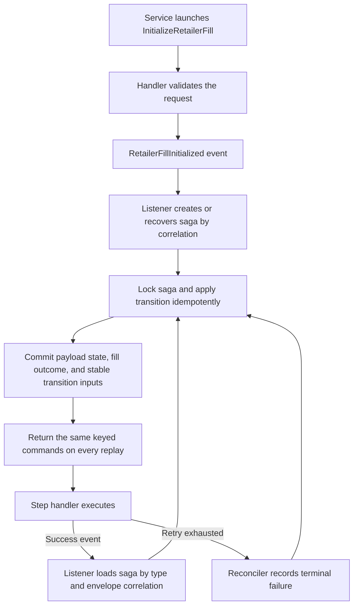

# Saga implementation

## Overview

Sagas coordinate reusable steps, track their outcomes, and decide what happens
next. The Shopify GraphQL initial-fill saga resolves storefront access, retrieves
catalog identifiers for each market/language context, fetches product details,
and follows them through extraction and structuralization.

Route every saga event using the saga type and the service's original correlation
ID from event-envelope metadata. Preserve that correlation in every descendant
command and event envelope. The saga ID is an internal persistence identity;
step payloads carry neither `run_id` nor `saga_id`. Stable command IDs distinguish
logical work across steps, contexts, and products.

## End to end flow



### Starting the flow

- The service dispatches `InitializeRetailerFill` with a correlation ID for each
  retailer. Validate unsupported requests before dispatch where possible.
- The handler validates the retailer/configuration and returns
  `RetailerFillInitialized`. It does not access saga storage or choose the token
  path. Remove `saga_id` from this event's payload; it carries the retailer.
- The initialization listener reads event metadata, creates or recovers the saga,
  and calls its initialization transition. The saga chooses token acquisition
  or direct catalog retrieval and records the selected contexts.

### Repeating the loop

- The listener loads the saga by type and correlation from event-envelope
  metadata and validates the retailer. Match the event's causation command ID
  against the saga's expected work before accepting its outcome.
- Apply the event's outcome once and commit any newly expected work in one
  transaction. Store sufficient immutable inputs to reproduce its commands.
- Return those same commands on every replay, even when the outcome was already
  recorded. Mulac drops commands whose IDs are already stored.
- Reconcile exhausted work into terminal outcomes. Evaluate the fill against
  the single definition in [Success Criteria](#success-criteria).

Other subscribers, including offer import preparation, may continue after the
saga's own work becomes terminal. An empty command list does not prove success.

## Shared rules

- Preserve the original correlation ID in all descendant envelopes. Causation
  names the command or event that directly produced the next message.
- Initialization and subsequent step events use the same type/correlation
  routing rule. Require valid envelope correlation; do not infer it from a
  payload field, event ID, causation ID, or internal saga ID.
- Reusable step handlers perform work without accessing saga storage. Listeners
  handle persistence; the saga owns sequencing and outcome rules.
- Store identity once in the saga record. Pass record identity and retailer to
  domain methods as context instead of duplicating them in the JSON payload.
- Commit progress before returning commands. Replaying a transition returns the
  same command IDs and payloads without counting its outcome twice.
- Retain the queue rows and transition inputs needed for the supported replay
  lifetime. Stable IDs cannot deduplicate against deleted command rows.
- Account for terminal failures as well as successful events. Pending work must
  not be mistaken for success or silently abandoned.

## Steps in execution order

| Step                          | Command → event                                                 | Purpose                                                                                                         |
| ----------------------------- | --------------------------------------------------------------- | --------------------------------------------------------------------------------------------------------------- |
| 1. Initialize                 | `InitializeRetailerFill` → `RetailerFillInitialized`            | Validate the request. The event listener creates or recovers the saga, whose transition chooses the token path. |
| 2. Acquire token, when needed | `AcquireStorefrontToken` → `StorefrontTokenAcquired`            | Resolve storefront access according to retailer policy. Tokenless retailers skip this step.                     |
| 3. Retrieve catalog           | `FetchProductCatalogIdentifiers` → `ProductCatalogIdsRetrieved` | Collect product IDs for each requested context using the resolved access.                                       |
| 4. Fetch details              | `FetchOfferDetails` → `OfferDetailsFetched`                     | Fetch and store raw product details for each product/context.                                                   |
| 5. Extract details            | `ExtractOfferDetails` → `OfferDetailsExtracted`                 | Produce the retailer's extracted model from the stored source.                                                  |
| 6. Structuralize details      | `StructuralizeOfferDetails` → `OfferDetailsStructuralized`      | Produce and store structured offer details.                                                                     |

These command/event names exist in the code. Extraction proceeds directly to
structuralization; there is no separate GraphQL normalization step. Failure
reconciliation supplements the success-event path described in the table.

## Expected changes

### Saga repository, record, & schema

Assume a fresh database and empty queues. The three migrations
`2026-11-19-000001_shopify_graphql_initial_fill_sagas`,
`2026-11-19-000002_shared_sagas`, and
`2026-11-19-000003_shopify_saga_identity` are branch-only relative to local `main`
at review. Replace them with one migration creating the final `sagas` table. Its
down migration drops that table. Recheck that these migrations remain unshipped
before changing them; previously migrated development databases need explicit
recreation, not a fabricated rollback chain. There is no separate progress
table; all saga state lives in the payload.

The saga record retains retailer code and a JSON object payload holding the
configuration snapshot and all progress state (see
[Saga behavior and payload state](#saga-behavior-and-payload-state)), with these
required identity and status fields:

| Field            | Rust type | Database type   | Requirement                                                              |
| ---------------- | --------- | --------------- | ------------------------------------------------------------------------ |
| `id`             | `Uuid`    | `UUID NOT NULL` | Independent UUID v7; sole primary key and internal command-ID namespace. |
| `status`         | `String`  | `TEXT NOT NULL` | Saga status (`in_progress`, `succeeded`, `failed`).                      |
| `saga_type`      | `String`  | `TEXT NOT NULL` | Stable type from `S::TYPE`.                                              |
| `correlation_id` | `Uuid`    | `UUID NOT NULL` | Original flow correlation; unique together with saga type.               |

- Use `succeeded` for successful terminal sagas in this phase.
- Enforce `UNIQUE (saga_type, correlation_id)`; different saga types may share
  a correlation ID. Reusing a type/correlation pair with a different retailer
  is a conflict.
- Generate the saga ID with `Uuid::now_v7()`. Validate version and RFC variant for
  both IDs at the Rust record boundary and in PostgreSQL. Reject type mismatches
  on reads/writes; retain non-null fields and the JSON-object constraint.
- Remove `saga_id` and `retailer_code` from `ShopifyGraphQlInitialFillSaga`'s
  serialized payload, adapting its methods and fixtures to record context.
  The unshipped identity-copy migration is removed as part of consolidation.
- Update the Diesel declaration to `sagas (id)`.
- Add an index on the `status` column to support reconciler queries.

The service and CI target PostgreSQL 18. Check both `id` and
`correlation_id` with the native `uuid_extract_version()` function from the
[PostgreSQL 18 UUID API](https://www.postgresql.org/docs/18/functions-uuid.html):

```sql
-- uuid_extract_version() returns NULL for UUIDs that lack the RFC 9562
-- variant, and a CHECK passes on NULL. COALESCE makes those fail, so this
-- one expression enforces both the version and the variant.
CHECK (COALESCE(uuid_extract_version(id), 0) = 7)
```

Apply the same expression to `correlation_id`, with both columns `NOT NULL`.

The repository needs these contracts:

- Create-or-load by `(saga_type, correlation_id)` using the unique constraint,
  then validate the persisted retailer. Concurrent initialization must converge
  on one record. Propagate other database errors.
- Find by type and event-envelope correlation without a retailer filter for all
  saga event listeners; validate retailer ownership before applying an event.
  Keep primary-ID access for internal persistence and reconciliation.
- Provide a transaction-scoped transition operation using one connection.
  Separate calls to the current `find` and `save`, which each acquire their own
  connection, cannot protect a read-modify-write with `FOR UPDATE`.
- Every transition locks the saga row with `SELECT ... FOR UPDATE`, applies the
  event to the payload, evaluates the fill outcome, and writes the record back
  in the same transaction. Events for one saga are therefore applied one at a
  time, so two concurrent final events cannot both miss completion.

### Initialization through event metadata

Keep the pinned Mulac 0.5.0 API. Its `HandlerWrapper` already copies command
correlation, falling back to command ID when absent, into returned events.
`on_commands_envelope` exposes that metadata to listeners.

- Remove saga creation and the repository dependency from the initialization
  handler. Validate the retailer/configuration there and emit the event.
- In the `RetailerFillInitialized` listener, require a valid UUID v7 correlation
  ID in the event envelope. An explicitly invalid correlation is rejected, not
  replaced. Do not fall back to event ID or event causation in the listener.
- Create or recover the saga, validate its retailer, snapshot its requested
  contexts/token policy, and apply initialization transactionally. Repeated
  initialization events with different event IDs but the same correlation must
  reuse the same saga and planned commands.
- A missing saga is expected for the first initialization event. Other shared-step
  events do not create sagas; unmatched events are ignored, while malformed
  matching events and database errors propagate.
- Shared-step events must match an expected command in the loaded saga's
  payload state. Different saga types may share a correlation without consuming
  each other's work. Ignore events with no expected work for this saga; reject
  conflicting retailer, step, context, or product data for matched work.

This removes the need for a contextual command-handler API, Mulac release, or
cross-repository implementation dependency. The existing command-to-event and
event-to-command correlation behavior remains in place.

### Saga behavior and payload state

Implement transitions through all six steps. Both access paths converge on the
same catalog builder. Snapshot the initial context list and token decision once;
replaying an event must not pick up a changed retailer inventory.

Store all progress in the saga's JSON payload; there is no separate progress
table. The payload holds:

- the configuration snapshot: requested contexts, the token decision, and the
  acquired storefront token once known;
- one entry for token acquisition and one per requested catalog context, each
  with status, diagnostic reason, and accepted result;
- one compact entry per product/context, keyed by requested context and
  product ID, with its current step, status, reason, and a small reference to
  the accepted result of that step (object ID and event ID).

An illustrative shape; field names may change during implementation:

```json
{
  "contexts": [{ "country": "DE", "language": "de" }],
  "storefront_token": "…",
  "token": { "status": "succeeded" },
  "catalogs": {
    "DE/de": { "status": "succeeded", "product_count": 2 }
  },
  "products": {
    "DE/de/gid://shopify/Product/1": {
      "step": "StructuralizeOfferDetails",
      "status": "succeeded",
      "result": { "object_id": "…", "event_id": "…" }
    },
    "DE/de/gid://shopify/Product/2": {
      "step": "FetchOfferDetails",
      "status": "failed",
      "reason": "…"
    }
  }
}
```

- Keep entries compact. Do not store per-product command payloads; rebuild each
  command from the configuration snapshot, the entry's key, and its accepted
  result reference.
- Preserve requested context identity separately from any resolved context
  returned by the retailer.
- Match an event by recomputing the expected command ID from the entry's key and
  comparing it with the event's causation ID. Entries are keyed by logical
  identity, so duplicate events cannot create duplicate work.
- Use pending, succeeded, failed, and skipped outcomes with diagnostic reasons.
  Downstream work blocked by a failed upstream step must not remain pending
  indefinitely.
- Store the first accepted result for each logical step, including its event
  identity. A command retry can emit a new event ID; event-ID deduplication alone
  is not enough. Repeated results reuse the canonical result and its downstream
  command inputs.
- Record a catalog result and its full expected product set in the same
  transition. Count unique entries, not events received. Missing or failed
  catalogs prevent a successful fill.
- Evaluate the fill outcome in each transition, under the saga row lock, and
  mark the saga terminal once.

Every event rewrites the whole payload, because PostgreSQL rewrites a JSONB value
in full even through `jsonb_set`. Total write volume therefore grows with the
square of the catalog size. Accept that cost for this phase. If fill sizes make
it too slow, revisit the storage design in a new ADR, for example row-based
progress or an event-sourced saga.

### Listener registration and step contracts

Register the repository-backed listener from startup, replacing the free-function
saga registrations. Use the existing saga subscriber identity and envelope-aware
subscriptions for initialization, token, catalog, fetched, extracted, and
structuralized events.

- Expose step commands, events, and constructors through the step interfaces.
  Extend `ApplicationCommand` through detail fetching and processing.
- Remove `run_id` from token, catalog, and detail commands/events, including the
  fetched-event payload nested in extraction and structuralization contracts.
  Do not replace it with a payload `correlation_id` or `saga_id`; transport
  metadata carries correlation and handlers remain independent of saga storage.
- Remove the unused `run_id` field from `KeyedCommand` and update its constructors
  and encoding. Keep its stable command `id`; both dispatch adapters already
  take correlation and causation from the triggering event envelope.
- Transfer next-step dispatch ownership from automatic step reactions to the
  saga. Separate handler registration from reaction registration and retain one
  dispatch owner per transition.
- Reuse the existing handler implementations and preserve unrelated subscribers,
  including offer import preparation. Remove the obsolete explicit saga-ID
  listener argument and payload/run-ID lookup assumptions.
- Return replayed transition commands even if the saga has progressed further.
  Queue deduplication handles already recorded commands; a processed-event
  marker must not suppress recovery after partial dispatch.

### Envelope correlation and stable command identities

The listener loads the saga by type and envelope correlation, then supplies its
internal record ID to command builders as an identity namespace. That namespace
is used to compute stable command IDs and is not serialized into step payloads.
Both access paths use the context-keyed builder implemented by the free functions
`initial()` and `keyed()` in `src/steps/graphql/product_catalog_ids/reacts_to.rs`.
Refactor these builders to accept the internal namespace separately from command
data. `initial()` also accepts the persisted context snapshot rather than
rereading live inventory on replay. Saga transitions own downstream command
construction, so builders do not need to recover a namespace from step events.

- Namespace the token command by the internal saga ID and command name.
- Preserve the existing catalog key shape: command name, country, language, and
  the historical trailing null cursor, namespaced by the internal saga ID.
- Preserve detail command keys containing retailer, country, language, and
  product ID, also namespaced by the internal saga ID. Preserve
  extraction/structuralization keys based on source object identity. The saga's
  persistence ID must never replace the original envelope correlation.
- Make `ApplicationCommand::encode` retain the builder's keyed command identity.
  Replace its current catalog encoding by `(run_id, NAME)`; using only saga ID
  and command name would still collide across contexts.
- Raw artifacts use their own object-storage identity; derived artifacts use
  source object IDs. Update development listings and dump consumers to expose
  `correlation_id` from stored event-envelope metadata in place of payload
  `run_id`. Preserve context-separated dump directories and prove that the same
  product in two contexts produces distinct artifacts without a payload run ID.
- Group and trace executions using envelope correlation at adapters/listeners
  that receive metadata. Replace handler logs that read payload `run_id` with
  available business context and artifact identifiers; do not add payload
  identity fields or a contextual handler API solely for logging.

### Replay recovery and retention

Use idempotent transitions plus repeated stable command dispatch. Mulac 0.5.0's
command repository inserts with `ON CONFLICT DO NOTHING`; partial dispatch can
therefore recover by returning the full command set again. No dispatch outbox or
transaction spanning saga storage and the command gateway is required for this
approach.

- Persist canonical transition inputs/results in the saga transaction before
  dispatch. Rebuild the same command IDs and payloads from them on every replay,
  including after configuration changes or later saga transitions.
- Stale storefront-token handling is outside this phase. Persist the acquired
  token with the canonical command inputs and replay it unchanged. Do not add
  expiry detection, token refresh, or execution-time credential resolution in
  this phase. Deduplication does not guarantee token validity for newly queued
  or delayed commands; resulting errors follow the ordinary retry and
  terminal-failure rules.
- If saving fails, return an error without dispatch. If dispatch fails, let the
  event retry: existing command rows are ignored and missing rows are inserted.
- Retain completed and failed command rows, triggering events, and canonical
  transition records indefinitely, the supported replay lifetime for this phase. The inspected code
  contains no automatic command purge, but that is not a retention guarantee.
  The initial implementation must not purge these records. Any later cleanup
  must define a closed replay horizon or retain separate deduplication tombstones.
- Queue deduplication covers repeated enqueueing, not repeated handler execution
  after a crash. Keep derived writes idempotent. Raw fetch retries can create
  extra immutable objects; accept one canonical result per logical fetch so
  those duplicates cannot fork downstream work or inflate completion.

### Failure observation and terminal outcomes

`HandlerPort` maps errors to `CommandError::Storage`, and unsuccessful handlers
emit no success event. In the pinned Mulac PostgreSQL repository, failures remain
`Failed`; reservation excludes rows with `attempts >= max_attempts` (default 6).
The reconciler must not wait for a transition to `Dead`.

Use a local queue reconciler as the default failure-observation mechanism:

- Associate commands with saga entries by correlation and recomputed command
  ID. Detect `Failed` rows exhausted under the same attempt policy as
  the runner. Do not count a reserved or still-retryable command as terminal.
- Reconcile already published result events before declaring their command
  failed. A command can fail after publishing an event; pending success-event
  delivery must not be mistaken for absent output or overwrite a saved success.
- Detect exhausted delivery of relevant saga events too, so partial-dispatch
  recovery cannot leave the fill running forever after event retries stop.
  Account for successors whose expected entries exist but whose commands were
  never queued; record the dispatch failure without inventing completed work.
  Do not treat failures of unrelated subscribers as failed product processing
  when the saga's transition already committed.
- Record exhausted work as failed with its reason, through the same locked
  saga transition, and account for blocked downstream steps. An intake failure
  before a saga exists remains visible in the initialization queue rather than
  fabricating a completed saga.
- Invoke reconciliation after manual command/event batches, with a pass on
  startup. Command workers remain disabled in this phase and event processing
  remains explicitly driven. If workers are enabled later, add periodic
  reconciliation to their lifecycle. Reconciliation failures must be visible
  and retryable; they must not silently mark work complete.
- Explicitly identified disappearance/unpublication may be recorded as skipped,
  with evidence and a reason. Do not infer that from an arbitrary error string,
  HTTP failure, or retry exhaustion. Unclassified errors remain failures.
- Empty catalogs are successful catalog outcomes with zero products. Missing or
  empty retailer configuration fails validation. A new fill is the default way
  to retry a terminal failed run; replay does not silently reopen it.

Completion and success are distinct; their acceptance policy is defined only in
[Success Criteria](#success-criteria).

### Verification, visibility, and documentation

Update existing pipeline tests to run through the registered saga listener and
inspect persisted progress and artifacts. Add a live path starting through the
API; the current live test directly invokes handlers and saves one raw product.
Database inspection is sufficient for initial reporting; a progress endpoint can
be added later.

Record the changed initialization boundary, progress storage, identity scheme,
replay/retention contract, and terminal-outcome policy in new ADRs and update the
ADR index and Shopify walkthrough. Preserve the existing accepted ADRs and
supersede them where necessary.

## Implementation and Verification

### Current status

Storage, initialization, step contracts, durable transitions and queue failure
reconciliation are implemented. See [ADR 93](../adr/0093-saga-storage-and-identity.md),
[ADR 94](../adr/0094-saga-execution-replay-and-recovery.md).

Verification on 2026-11-20 passed service and development-app `make ci`, all 96
PostgreSQL tests on PostgreSQL 18.6, and the service health smoke check. The queue
suite covers canonical results, concurrent completion, partial dispatch,
exhausted commands/events, pending duplicate recovery, retention violations and
observer error recovery. A completed 1,000-product payload measured 390,251 JSON
bytes; one locked replay took approximately 43 ms locally.

Both API-driven live fills reached `succeeded` and verified every structured
artifact, including product identity, variant counts, language, currency and
standard/discounted pricing:

| Retailer  | Access                    | Verified structured artifacts | Resolved contexts                                                              |
| --------- | ------------------------- | ----------------------------: | ------------------------------------------------------------------------------ |
| Anker AU  | Acquired storefront token |                           152 | AU/EN/AUD: 152                                                                 |
| Ugreen EU | Tokenless                 |                         1,234 | BG/BG/EUR: 247; AT/DE/EUR: 247; CZ/CS/EUR: 247; DE/EN/EUR: 246; DK/DA/EUR: 247 |

Ugreen also exercised concurrent manual HTTP batches from a second service
process against the same isolated test schema, with command workers disabled.
Both fills retained distinct raw and structured object identities for every
product/context. The live test saved non-secret result-reference manifests in
the system temporary directory. Temporary service processes were stopped and
the isolated schemas were cleaned up after verification.

The choices above use Mulac 0.5.0, envelope-correlation routing, internal saga
identities, payload-based progress, replayed stable commands, queue
reconciliation, and a consolidated migration. Track this work in [TODO.md](../../TODO.md).

### Delivery order

1. Consolidate the unshipped migrations and implement the saga record,
   uniqueness, PostgreSQL 18 checks, and locked transaction-scoped transitions.
2. Move saga creation into the initialization listener, simplify the handler/event,
   and remove duplicated identity from the saga payload.
3. Expose reusable step contracts and context-keyed command builders. Use the
   persisted context snapshot and internal saga ID for command identities on
   both access paths. Remove payload/wrapper `run_id` and update metadata
   consumers to use envelope correlation.
4. Implement transitions, canonical results, payload progress state, and replayed
   dispatch. Register saga listeners and remove duplicate dispatch owners.
5. Implement queue failure reconciliation and terminal outcome evaluation,
   including exhausted event delivery.
6. Complete queue/migration verification and then run both retailers through the
   API to their final outcomes and inspect structured artifacts.

### Verification cases

| Area                   | Required evidence                                                                                                                                                                                                                                                                                                                                                 |
| ---------------------- | ----------------------------------------------------------------------------------------------------------------------------------------------------------------------------------------------------------------------------------------------------------------------------------------------------------------------------------------------------------------- |
| Schema and migration   | Single create/drop migration on a fresh database; PostgreSQL 18 UUID version and variant checks, including a rejected non-RFC-variant UUID; non-null fields; primary key; payload has no duplicate identity.                                                                                                                                                      |
| Uniqueness             | Reject reused saga IDs and duplicate type/correlation mappings; allow different types to share correlation; reject wrong-retailer reuse.                                                                                                                                                                                                                          |
| Initialization         | Handler emits the validated event without touching saga storage; first listener creates the saga; concurrent/repeated events recover it; missing or invalid event correlation fails.                                                                                                                                                                              |
| Progress               | One payload entry per catalog and product/context; duplicate events and new event IDs from retried commands do not inflate counts; concurrent final events reach a terminal fill once.                                                                                                                                                                            |
| Command identity       | Internal saga namespaces yield distinct stable token/catalog/detail IDs across sagas and contexts; extraction/structuralization preserve source-object keys; step payloads contain no `run_id` or `saga_id`; replay after configuration changes returns identical command payloads.                                                                               |
| Dispatch recovery      | Crash after progress commit and fail midway through dispatch; replay returns the full original command set, recording only missing commands while retained completed rows suppress duplicates.                                                                                                                                                                    |
| Handler retries        | Repeat a fetch/storage write or publish after a crash; select one canonical step result and prove only one downstream work chain is counted.                                                                                                                                                                                                                      |
| Retention              | Preserve deduplication rows and canonical inputs through the replay lifetime; demonstrate the failure mode if completed commands are deleted and prohibit that cleanup policy.                                                                                                                                                                                    |
| Failure reconciliation | Retryable versus exhausted commands, published-but-pending successes, exhausted saga event delivery, unrelated subscriber failures, disappearance, and blocked downstream steps all have explicit outcomes.                                                                                                                                                       |
| Correlation            | Distinct internal saga and envelope correlation IDs; every saga listener routes by type/envelope correlation; missing or invalid correlation fails without a payload fallback; shared-correlation saga types accept only their expected work; command/event IDs remain distinct and original correlation and immediate-parent causation survive every transition. |
| Artifact metadata      | Development listings and dump consumers use envelope `correlation_id`; the same product in two contexts retains distinct artifacts and context-separated dump paths without payload `run_id`.                                                                                                                                                                     |
| End-to-end             | Start token and tokenless retailers through the API, drive both queues and reconciliation, inspect all requested contexts and stored structured outputs, and apply Success Criteria.                                                                                                                                                                              |

Use controlled step responses for deterministic retry and failure scenarios.
Measure payload size and transition time at realistic catalog sizes, since every
event rewrites the saga payload. Run migrations and database checks against
PostgreSQL 18, the version CI runs.

For implementation changes, run `make fmt`, then `make ci` in affected
workspaces, focused PostgreSQL migration/repository/queue tests, and applicable
smoke tests. Run `make audit` only when Cargo dependencies or lockfiles change.
Start retailer sourcing with `PORT=<port> make serve` and verify `/api/health`.

### Files and dependencies

Paths beginning with `src/` are relative to `services/retailer_sourcing`.

| Area               | Expected changes                                                                                                                                                                                                                |
| ------------------ | ------------------------------------------------------------------------------------------------------------------------------------------------------------------------------------------------------------------------------- |
| Saga storage       | Consolidated migration; `src/saga/schema.rs`, `saga.rs`, `saga_repository.rs`, and locked transitions over the payload.                                                                                                         |
| Initialization     | `src/steps/graphql/initialize_retailer_fill.rs`; handler registration no longer injects a repository.                                                                                                                           |
| Saga behavior      | `src/saga/shopify_graphql_initial_fill/model.rs`, `listener.rs`, and `mod.rs`; envelope-correlation lookup, record context, transitions, and completion.                                                                        |
| Step interfaces    | `src/steps/prelude.rs`, GraphQL contracts, keyed builders, and registration modules; remove payload `run_id` and keep internal namespaces in command construction.                                                              |
| Replay             | Preserve builder identities in `ApplicationCommand`; remove unused `KeyedCommand.run_id` in `src/platform/bus.rs` and update callers; canonical results in the saga payload and existing envelope metadata/Mulac deduplication. |
| Metadata consumers | Development source listings, dump consumers in `apps/development`, handler logs, and fixtures; replace payload-run grouping with envelope correlation while preserving artifact/context identity.                               |
| Reconciliation     | Local queue observer and saga state updates; startup/background lifecycle and manual runner integration.                                                                                                                        |
| Verification       | Saga and pipeline PostgreSQL tests, failure/replay fixtures, artifact checks, and API-driven live verification.                                                                                                                 |
| Documentation      | New ADRs and index entries, service/Shopify walkthrough, retention and terminal-outcome contracts.                                                                                                                              |
| CI                 | `.github/workflows/ci.yml`: run the PostgreSQL service images at version 18.                                                                                                                                                    |

No Mulac dependency change is required by this design.

## Success Criteria

A fill is terminal when every requested catalog has a terminal outcome and every
known product/context has succeeded, failed, or been explicitly skipped, with
no unresolved saga transition or pending downstream work. Failed catalog
retrieval means coverage is incomplete even if all already discovered products
are accounted for.

Retain the agreed strict success policy: every requested catalog must succeed
and every discovered product/context must reach structuralization successfully.
A fill with failures or skips is terminal but unsuccessful; queue emptiness and
"all accounted for" alone do not imply success.

Set saga status to `succeeded` only when the fill is terminal and meets the
strict success policy. Set it to `failed` when terminal with any failed or
skipped catalog or product work. Otherwise keep it `in_progress`.

Verify two different retailers through the API: one using an acquired Storefront
token and one without a token. Both must meet that policy and produce structured
artifacts with the expected product identity, market/language, variants, and
pricing. The live verification must include actual products, not only empty
catalogs. Failure scenarios must also demonstrate terminal outcomes rather than
indefinitely pending sagas.

## Open Questions

- Should explicitly verified product disappearance/unpublication be an allowed
  skip for success? Until that policy is changed, the strict criterion above
  remains in force; technical failures never count as success.

## Review fixes

Saga subscriptions precede step subscriptions through shared production/live-test
registration. Unmatched work is ignored before validating retailer ownership.
Start requests validate all configurations before enqueueing and return HTTP 202
with retailer/correlation receipts; synchronous dispatch uses the blocking pool.

Startup and manual batches sweep reservations older than five minutes. Shared
PostgreSQL advisory locks protect active batches; exclusive sweeps defer while
batches run. Dedicated guard connections survive request cancellation until the
blocking work finishes. Workers remain disabled, and recovery after the timeout
requires another manual batch. Per-saga decoding/validation failures are logged
with identity and counted; infrastructure errors remain fatal. Reconciliation
reports scanned, changed and failed counts.

A follow-up migration indexes both queue correlation expressions without resetting
development data. No-op transitions avoid rewriting saga rows while still returning
replay commands. Decisions are consolidated in ADRs 93 and 94. Token refresh,
atomic multi-retailer insertion and background workers remain outside this phase.

Review-fix verification passed service `make fmt` and `make ci`, and all 103
PostgreSQL integration tests on PostgreSQL 18.6. Coverage includes exhausted
import delivery with production registration, malformed-saga isolation,
unchanged replay writes, retailer matching, correlation-index migration
round trips, coordinated command/event recovery, and cancellation of a batch
waiter while its blocking work remains protected.
